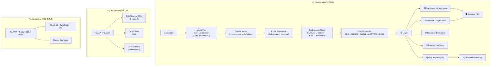

> ⚠️ **Historical brainstorm (June–July 2026).** Several statements about the v1 app are
> inaccurate — e.g. Kalman/EMA stabilisation, a face-missing alarm, a Gauss–Jordan solver,
> the body map "working". See [AUDIT.md](AUDIT.md) for the verified description.

# LumiIQ — Deep Research & Brainstorm

## Executive Summary

LumiIQ is an **assistive communication platform for paralyzed and locked-in patients** (ALS, quadriplegia, stroke) that turns a standard webcam into a gaze-controlled interface — enabling hands-free typing, bilingual speech synthesis, anatomical symptom reporting, and automated medical distress alarms. The project is technically ambitious and contains impressive algorithmic depth, but is currently fragmented across **three divergent codebases** at different maturity levels.

---

## 1. Current State of the Project

### What Works (v1 Root App — ✅ Fully Operational)

| Feature | Status | Implementation |
|---|---|---|
| Gaze tracking via webcam | ✅ Working | MediaPipe FaceLandmarker (478 landmarks) |
| Multi-point calibration | ✅ Working | 5/9/16/25 points, R² quality scoring |
| Ridge regression mapping | ✅ Working | Polynomial features + cross-validated λ |
| Triple-layer stabilization | ✅ Working | One Euro + Kalman + EMA + deadband |
| Dwell-to-click keyboard | ✅ Working | 4-stage state machine (1200ms dwell) |
| Word prediction & autocorrect | ✅ Working | 100+ medical terms, bigram context, Levenshtein |
| Bilingual TTS (EN/HI) | ✅ Working | Web Speech API with auto-detection |
| Anatomical body map | ✅ Working | 10 zones × 6 symptoms, bilingual phrases |
| Emergency distress alarms | ✅ Working | Rapid blink, prolonged closure, face loss |
| Caregiver dashboard | ✅ Working | Live feed, timeline, settings sliders |
| SQLite persistence | ✅ Working | WAL mode, auto-trimmed logs |
| Unit tests (gaze math) | ✅ 28 passing | `jsc gaze/test_gaze.js` |

### What's Incomplete

| Component | Issue |
|---|---|
| **v3 Standalone** (`backend/` + `frontend/`) | `GazeService.process_frame()` is a `pass` stub. Frontend doesn't load gaze scripts. Tests directory empty. |
| **Platform / Eyra / LumiIQ** (`platform/`) | DB repositories & schemas empty. Zero git commits. Tests empty. Mid-build SaaS rewrite. |
| **Cross-version coherence** | Three codebases drift independently with no shared module boundary. |

> [!WARNING]
> The aspirational docs (`SYSTEM_READY.md`, `IMPLEMENTATION_COMPLETE.md`) claim "PRODUCTION-READY" status for v3, but the actual code has critical stubs and missing wiring. This gap could mislead contributors or stakeholders.

---

## 2. Architecture Map



---

## 3. Technical Deep Dive — What Makes This Impressive

### 3.1 Gaze-to-Screen Mapping Pipeline

The mathematical rigor is exceptional for a web application:

1. **Feature extraction**: 478 MediaPipe landmarks → normalized iris positions + head Euler angles + EAR
2. **Polynomial expansion**: 2nd-degree features (squares + cross terms) from 8-dim input
3. **Ridge regression**: Gauss-Jordan solver with partial pivoting, Z-score standardization
4. **Hyperparameter tuning**: 5-fold cross-validated $R^2$ to auto-select $\lambda$
5. **Outlier rejection**: MAD-based (> 4 MAD) during calibration

$$\hat{y} = (Z^T Z + \lambda I)^{-1} Z^T y$$

### 3.2 Multi-Layer Stabilization

Each filter addresses a different noise characteristic:

| Layer | Purpose | When It Helps |
|---|---|---|
| **Outlier Rejection** | Drops jumps > 10% screen | Head bumps, tracking glitches |
| **One Euro Filter** | Speed-adaptive smoothing | Smooth fixation, fast saccade tracking |
| **Kalman Filter** | Prediction + measurement fusion | General sensor noise |
| **EMA + Deadband** | Lock cursor when Δ < 0.2% | Micro-jitter during dwell |

### 3.3 Dwell State Machine

The 4-stage machine is well-designed to prevent false activations:

$$\text{IDLE} \xrightarrow{150\text{ms focus}} \text{FOCUSING} \xrightarrow{1200\text{ms dwell}} \text{DWELLING} \xrightarrow{\text{click}} \text{ACTIVATION} \xrightarrow{600\text{ms}} \text{COOLDOWN}$$

Adaptive dwell ($0.85\times$ to $1.15\times$) speeds confirmation when gaze is rock-steady.

### 3.4 Eye Safety Monitoring

| Detection | Trigger | Response |
|---|---|---|
| Prolonged closure | EAR < 0.18 for ≥ 3s | Distress alarm + siren |
| Rapid blinking | ≥ 6 blinks in 3s | Eye irritation alert |
| Face missing | No detection for ≥ 5s | Session pause + warning |
| Head droop | Pitch > 45° | Alert + face loss handling |

---

## 4. Identified Issues & Risks

### 🔴 Critical

1. **CDN dependency for MediaPipe** — WASM + model files load from `cdn.jsdelivr.net` and `storage.googleapis.com`. In hospital networks with restricted internet, the app will fail to initialize. **Must bundle locally.**
2. **Web Audio autoplay blocking** — Emergency siren uses `AudioContext`, which browsers block until user interaction. If first event is a distress blink before any click, the siren is silently suppressed. **Must unlock audio context on first gaze dwell.**
3. **v3 backend gaze stub** — `GazeService.process_frame()` is literally `pass`. No WebSocket wiring from client video to server CV pipeline. This is the core feature.

### 🟡 Important

4. **Three divergent codebases** — v1, v3, and Platform share no modules, no common test suite, and drift independently. Technical debt will compound rapidly.
5. **Documentation overpromises** — `SYSTEM_READY.md` and `IMPLEMENTATION_COMPLETE.md` claim production readiness that doesn't match the code. This is a credibility risk.
6. **Python version lock** — Dependencies require 3.11 (OpenCV/MediaPipe C-extensions fail on 3.14). Not documented prominently.
7. **No automated CI/CD** — No GitHub Actions, no lint checks, no test runners beyond manual `jsc` invocation.
8. **Camera resource leak** — Stopping tracking stops media tracks but doesn't clean up `loadeddata` event listeners.

### 🟢 Nice to Fix

9. **Global namespace pollution** — All modules are window globals (`EyeApp`, `LumiGaze`, etc.). Should migrate to ES modules.
10. **Branding inconsistency** — Project is called "LumiIQ", "Eyra", and "LumiIQ" across different directories.
11. **No i18n framework in v1** — Hindi strings are hardcoded. Platform has i18next for 20 locales but isn't wired to the working app.

---

## 5. Competitive Landscape & Differentiation

### Existing Solutions

| Product | Approach | Cost | Limitation |
|---|---|---|---|
| **Tobii Dynavox** | Dedicated IR eye tracker hardware | $5,000–$15,000 | Expensive, requires specific hardware |
| **LumiGaze Edge** | Specialized camera + software | $7,500+ | Institutional only, not portable |
| **Google Project Relate** | Speech recognition for atypical speech | Free | Requires some speech ability |
| **Apple Switch Control** | Head tracking via TrueDepth camera | Built-in | Apple ecosystem only, no medical features |
| **GazePointer** | Webcam-based gaze (Windows) | Free | Desktop only, no medical integration |
| **LumiIQ (this project)** | Webcam + browser, medical-focused | Free/Open | Works on any device with a webcam |

### Key Differentiators 🎯

1. **Zero specialized hardware** — Any webcam + browser (no IR tracker needed)
2. **Medical-specific features** — Body map, symptom logging, distress alarms, caregiver dashboard
3. **Bilingual by design** — English/Hindi with automatic script detection
4. **Offline-first** — localStorage fallback + zero-dependency Python server option
5. **Open source** — No licensing cost barrier for hospitals in developing countries

### Where LumiIQ Falls Short vs. Tobii

- **Accuracy**: IR trackers achieve ~0.5° accuracy; webcam-based achieves ~2-5° (acceptable for large-target dwell UI, not pixel-precise)
- **Robustness**: IR is lighting-invariant; webcam degrades in low light, backlighting, glasses
- **Latency**: Dedicated hardware runs at 60-300Hz; browser ML runs at 15-30 FPS
- **Clinical certification**: Tobii has FDA/CE marks; LumiIQ has none

---

## 6. Brainstorm — Features & Improvements

### 🚀 High-Impact, Feasible Now

| Idea | Impact | Effort | Notes |
|---|---|---|---|
| **Bundle MediaPipe locally** | Enables offline hospital deployment | Low | Download WASM + `.task` model, serve from `/static/` |
| **Audio context unlock** | Fixes silent emergency sirens | Low | Resume `AudioContext` on first dwell activation |
| **Consolidate to single codebase** | Stops technical debt bleeding | Medium | Pick v1 (working) as canonical, migrate v3 ORM models in |
| **PWA manifest + service worker** | Install as app on tablet, offline caching | Medium | Perfect for bedside tablet deployment |
| **Add night mode / high contrast** | Better for dark hospital rooms | Low | CSS custom properties already in use |
| **Session analytics export** | Let caregivers download CSV reports | Low | Query existing SQLite log tables |
| **Calibration drift detection** | Remind user to recalibrate after accuracy drops | Medium | Track prediction error over time, compare to calibration R² |

### 🧠 Medium-Term Innovation

| Idea | Impact | Effort | Notes |
|---|---|---|---|
| **On-device ML model fine-tuning** | Improves accuracy per-patient over time | High | Cache gaze samples, retrain regression periodically |
| **Phrase banking / quick phrases** | "I need water", "Turn me", "Call family" as one-tap | Low-Med | Common care phrases as a dedicated tab |
| **Emotion/mood reporting** | Happy/Sad/Anxious/Tired via emoji selection | Low | Extend body map concept to emotional state |
| **Multi-language expansion** | Urdu, Tamil, Bengali, Arabic | Medium | Build on existing bilingual architecture |
| **WebRTC remote caregiver view** | Nurse station sees patient's screen remotely | High | Real-time screen mirroring + camera feed |
| **Attention fatigue detection** | Detect when patient is too tired for gaze input | Medium | Track EAR trends, saccade frequency decay, calibration accuracy degradation |
| **Medication reminder integration** | Timed alerts for medication schedules | Medium | CRUD interface in caregiver dashboard |
| **Smart word prediction via LLM** | Context-aware sentence completion | Medium | On-device small LLM (e.g., Gemma 2B) or API-based |

### 🔮 Long-Term Vision

| Idea | Impact | Effort | Notes |
|---|---|---|---|
| **BCI (Brain-Computer Interface) integration** | Supplement gaze with EEG signals | Very High | Research-grade, but companies like OpenBCI exist |
| **FDA 510(k) clearance pathway** | Clinical credibility, hospital procurement | Very High | Requires formal validation studies, QMS |
| **Multi-patient hospital dashboard** | Centralized nurse station monitoring | High | WebSocket-based multi-patient views |
| **Integration with EHR systems** | Auto-log symptoms to Epic/Cerner | High | HL7 FHIR APIs |
| **Voice cloning for patients** | Generate speech in patient's own voice (pre-illness recordings) | Medium-High | TTS models like XTTS, MARS5 |
| **Predictive health alerts** | ML on symptom trends to flag deterioration | High | Requires clinical validation |

---

## 7. Technical Recommendations

### Priority 1: Stabilize & Ship (Weeks 1-2)

```
1. [ ] Bundle MediaPipe WASM + model files locally (kill CDN dependency)
2. [ ] Fix AudioContext autoplay — unlock on first user interaction
3. [ ] Clean up event listener leaks on camera stop
4. [ ] Add PWA manifest + basic service worker for installability
5. [ ] Remove or clearly label aspirational docs (SYSTEM_READY, IMPLEMENTATION_COMPLETE)
6. [ ] Pin Python 3.11 requirement prominently in README
```

### Priority 2: Consolidate Architecture (Weeks 3-4)

```
1. [ ] Adopt v1 root as the single canonical source of truth
2. [ ] Migrate v3's SQLAlchemy models into a /backend module serving v1's frontend
3. [ ] Move JS modules to ES module imports (drop global namespace pattern)
4. [ ] Set up GitHub Actions CI: lint (ESLint + flake8), test (jsc + pytest), build check
5. [ ] Unify branding — pick ONE name (LumiIQ? Eyra? LumiIQ?)
```

### Priority 3: Enhance & Differentiate (Months 2-3)

```
1. [ ] Add quick-phrase tab (pre-built medical communication phrases)
2. [ ] Implement calibration drift detection + auto-recalibration prompts
3. [ ] Build session analytics dashboard with chart visualizations
4. [ ] Add emotion/mood reporting feature
5. [ ] Expand language support (Urdu, Tamil, Bengali at minimum)
6. [ ] Add attention fatigue detection based on EAR + saccade trends
```

---

## 8. Key Questions to Resolve

> [!IMPORTANT]
> These decisions will shape the project's direction:

1. **Target deployment**: Is this a bedside tablet app (PWA), a hospital-installed desktop app, or a cloud SaaS? This determines whether to invest in the Platform rewrite.
2. **Branding**: LumiIQ vs. Eyra vs. LumiIQ — which name goes forward? The codebase needs one identity.
3. **Monetization model**: Open-source community tool? Freemium SaaS? Licensed to hospitals? This shapes the architecture (single-tenant vs. multi-tenant).
4. **Regulatory intent**: Is FDA 510(k) or CE marking a goal? If yes, it changes development practices (traceability, formal testing, QMS documentation).
5. **Language priority**: Beyond Hindi, which languages matter most for the target patient population?
6. **v3/Platform fate**: Should the partially-built v3 and Platform codebases be completed, archived, or cannibalized for parts?

---

## 9. What Makes This Project Special

Despite the architectural fragmentation, this project has **genuinely impressive technical depth**:

- Custom **Ridge Regression with Gauss-Jordan solver** running in the browser — no ML framework dependency
- **One Euro Filter** implementation (a published CHI 2012 algorithm) for speed-adaptive smoothing
- **5-fold cross-validated hyperparameter tuning** entirely client-side
- **MAD-based outlier rejection** during calibration for robustness
- **4-stage dwell state machine** with adaptive timing — well-thought-out UX engineering
- **Dual-frequency sawtooth siren** synthesized via Web Audio API — no audio files needed
- **Bilingual auto-detection** (Devanagari script regex) for seamless Hindi/English switching

This is not a toy project — it's a genuinely thoughtful assistive technology system that could make a real difference for locked-in patients, especially in resource-constrained healthcare environments where Tobii-class devices are unaffordable.
